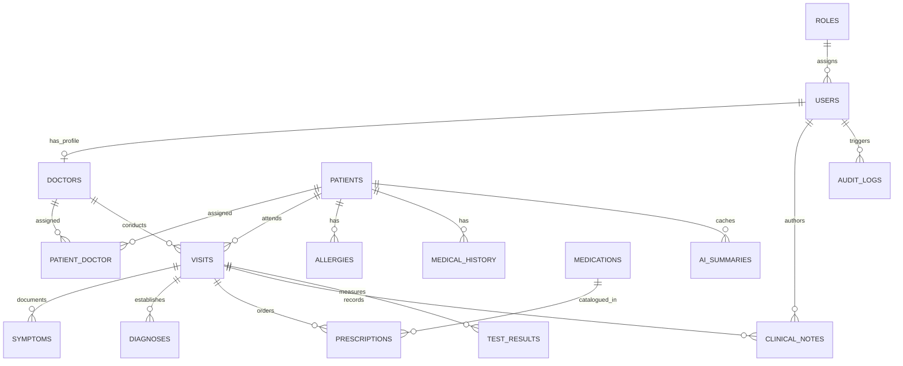

# MedVault AI: Engineering Audit, Architecture & Viva Guide

**Team Members:**
1. **Pushkar Panwar** (`2501730022`)
2. **Saksham Singh** (`2501730270`)

---

## 1. Problem Statement & System Design

Clinicians lose time hunting across separated visit notes, prescriptions, and lab sheets to trace recurring symptoms or medication changes. MedVault AI stores patient histories inside a normalised 13-table relational database and exposes two AI capabilities grounded strictly in stored rows:

1. **Citation-Verified Patient Summarisation (`GET /api/ai/patients/{id}/summary`):** Aggregates encounter timelines, symptom frequencies, ICD-10 diagnosis transitions, longitudinal lab values, allergies, and missing demographic fields.
2. **Natural-Language Historical Retrieval (`POST /api/ai/query`):** Parses temporal windows and clinical synonyms, queries relational child tables, and renders matching source records beside grounded answers.

---

## 2. Relational Database Design (3NF)

### Why This Schema Satisfies 3NF
- **1NF:** Multi-valued clinical attributes (symptoms, diagnoses, prescriptions, lab panels) sit in dedicated child tables linked by `visit_id`, eliminating repeating columns.
- **2NF:** Every attribute in associative tables (`prescriptions`, `patient_doctor`) depends on the full primary key.
- **3NF:** Medication metadata (`generic_name`, `drug_class`, `form`, `strength`) lives in `medications`, and clinician credentials (`license_no`, `specialization`, `department`) live in `doctors`, removing transitive dependencies from `prescriptions` and `visits`.

---

## 3. Principal Engineering & Design Audit Summary

| Audit Pillar | Finding | Implemented Fix | Files Changed |
|---|---|---|---|
| **Database & SQL (`supabase-postgres-best-practices`)** | Missing FK indexes on `users.role_id`, `visits.patient_id`, `visits.doctor_id`, `clinical_notes.author_id`; dashboard aggregated top symptoms and conditions in Python after full-table scans. | Indexed all FK columns, added a partial index on active patients, enforced vital-sign `CHECK` constraints (HR 20 to 300, SpO2 50 to 100), and rewrote dashboard analytics as SQL `GROUP BY` + `func.count()` queries. | `backend/app/models/__init__.py`, `backend/app/routers/dashboard.py`, `docs/DATABASE_SCHEMA.sql` |
| **Validation & Cache Coherence** | Blank patient names and out-of-range vitals lacked Pydantic guards; updating allergies or visits left stale `ai_summaries` rows. | Added `@field_validator` rules on `PatientCreate` and `VisitCreate`; invalidated `AISummaryCache` rows on profile, allergy, history, and visit mutations. | `backend/app/schemas/__init__.py`, `backend/app/routers/patients.py` |
| **Test-Driven Integrity (`tdd-guard`)** | A single test covered only the main happy path. | Built 7 focused invariant tests verifying 401/404/422/400 boundaries, SQL `GROUP BY` updates, cache invalidation, and zero-hallucination refusal. | `backend/tests/test_api.py` |
| **Frontend Craft (`impeccable`)** | Browser `alert()` calls broke flow; static cards mixed borders and shadows; modals lacked `role="dialog"` and `Escape` dismissal. | Added `ErrorBoundary`, dismissible error/status banners, loading skeletons, empty-state reset, `Esc` and `/` shortcuts, `Newsreader` + `IBM Plex Sans` + tabular numerals, and ARIA dialog roles. | `frontend/src/App.tsx`, `frontend/index.html`, `frontend/tailwind.config.js`, `frontend/src/index.css` |
| **Vector Diagrams & Editorial PDF (`canvas-design`, `taste`)** | Project lacked a print-ready technical report with non-overlapping vector diagrams. | Built `generate_pdf_report.py` with two 460pt ReportLab vector diagrams, padded tables, callout bars, and single-line footers. | `backend/scripts/generate_pdf_report.py`, `docs/MedVault_AI_Technical_Report.pdf` |
| **Prose & Visual Deck (`stop-slop`, `frontend-slides`)** | Docs contained AI filler and lacked a slide deck. | Rewrote documentation in direct active voice and built an 8-slide 1920x1080 HTML presentation accessible at `/presentation.html`. | `README.md`, `docs/presentation.html`, `frontend/public/presentation.html` |

---

## 4. Test Suite Invariants (`backend/tests/test_api.py`)

1. `test_health_and_metadata_invariant`: Health endpoint exposes system status and team roll numbers without auth.
2. `test_auth_and_rbac_boundary_invariant`: Protected routes return `401` on missing or tampered tokens, reject wrong passwords, and write login events to `audit_logs`.
3. `test_patient_crud_and_validation_boundaries`: Rejects blank names and invalid sex (`422`), returns `404` for missing IDs, generates unique MRNs, and updates demographics.
4. `test_visit_creation_and_sql_aggregation_invariant`: Rejects out-of-range SpO2 (`422`), stores nested clinical child records (`201`), and updates SQL `GROUP BY` dashboard counts.
5. `test_ai_summary_citation_grounding_and_cache_invalidation`: Enforces a `1.0` citation grounding score, flags missing fields on `MRN-2026-00006` and diagnostic revisions on `MRN-2026-00001`, and invalidates cached summaries on allergy writes.
6. `test_ai_natural_language_retrieval_and_zero_hallucination_guard`: Matches recurring headaches, rejects blank queries (`400`), and returns zero matches with an explicit refusal for unrecorded conditions.
7. `test_clinical_note_entity_extraction_boundaries`: Extracts symptoms, ICD-10 candidate diagnoses, and medications from SOAP text while rejecting empty notes (`400`).

---

## 5. Two-Member Work Allocation

| Member | Roll Number | Modules Owned | Primary Source Files |
|---|---|---|---|
| **Pushkar Panwar** | `2501730022` | 3NF Schema, Auth/RBAC, Patient & Visit CRUD APIs, Synthetic Storylines | `backend/app/models/__init__.py`, `backend/app/core/security.py`, `backend/app/core/deps.py`, `backend/app/routers/auth.py`, `backend/app/routers/patients.py`, `backend/app/db/seed_data.py`, `docs/DATABASE_SCHEMA.sql` |
| **Saksham Singh** | `2501730270` | Grounded AI Engine, NL Retriever, SQL Dashboard Aggregations, React UI, Slide Deck, PDF Report | `backend/app/ai/engine.py`, `backend/app/routers/ai.py`, `backend/app/routers/dashboard.py`, `frontend/src/App.tsx`, `frontend/src/api.ts`, `backend/tests/test_api.py`, `docs/presentation.html` |

---

## 6. 5-Minute Viva Demonstration Script

1. **Authenticate (30s):** Sign in on `/` or `https://ai-medical-records.vercel.app` using the preset for **Dr. Ananya Sharma, MD**.
2. **Inspect Dashboard (45s):** Point out the active patient count, total medical records, SQL `GROUP BY` symptom frequency list, and recent encounters table.
3. **Verify Longitudinal Records & Grounded Summary (90s):** Open **Aarav Mehta (`MRN-2026-00001`)**. Switch to **AI-Powered Grounded Summary**, highlight `100%` verified citations, note the detected recurring headache pattern and diagnostic evolution (`Tension-Type Headache [Ruled-out]` to `Migraine with Aura [Confirmed]`), and click `[SYM-1]` to open the **Source Record Inspector Drawer**.
4. **Demonstrate Missing Data Safeguard (30s):** Open **Zoya Farooqui (`MRN-2026-00006`)** and show that the AI flags her missing blood group and emergency contact instead of guessing.
5. **Test NL Retrieval & Refusal (45s):** Open **AI Historical Retrieval**, run *"Find previous records mentioning recurring headaches"*, then search *"Ebola"* to show zero-hallucination refusal.
6. **Launch Presentation Deck (20s):** Click **Presentation Deck** in the top header to present the 8-slide 16:9 architecture deck.
